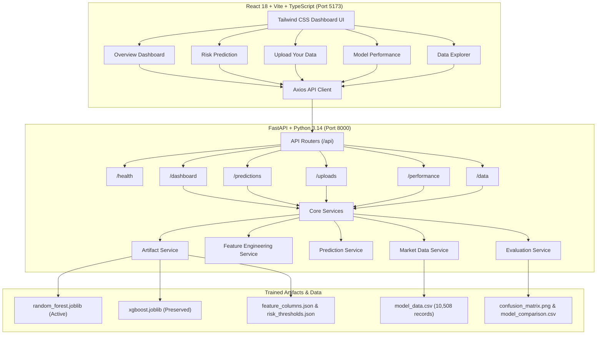

# InvestIQ — Investment Risk Intelligence

> **Smarter Insights. Better Investments.**

InvestIQ is a full-stack, machine-learning-driven equity volatility and investment risk intelligence web application. Built for academic research and quantitative equity analysis, it predicts forward 20-trading-day volatility regimes (**Low Risk**, **Medium Risk**, **High Risk**) for Indian blue-chip equities (`RELIANCE.NS`, `TCS.NS`, `INFY.NS`, `HDFCBANK.NS`) using chronological holdouts and verified ML estimators.

---

## Architecture Diagram



---

## Project Structure

```
InvestIQ_Final/
├── frontend/
│   ├── index.html
│   ├── package.json
│   ├── tsconfig.json
│   ├── vite.config.ts
│   ├── tailwind.config.js
│   ├── src/
│   │   ├── main.tsx
│   │   ├── App.tsx
│   │   ├── api/
│   │   │   └── client.ts
│   │   ├── components/
│   │   │   ├── Sidebar.tsx
│   │   │   ├── Header.tsx
│   │   │   ├── MetricCard.tsx
│   │   │   ├── RiskBadge.tsx
│   │   │   ├── StockChart.tsx
│   │   │   ├── ProbabilityChart.tsx
│   │   │   ├── DataTable.tsx
│   │   │   ├── LoadingState.tsx
│   │   │   ├── ErrorState.tsx
│   │   │   └── EmptyState.tsx
│   │   ├── pages/
│   │   │   ├── Overview.tsx
│   │   │   ├── RiskPrediction.tsx
│   │   │   ├── UploadData.tsx
│   │   │   ├── ModelPerformance.tsx
│   │   │   └── DataExplorer.tsx
│   │   ├── layouts/
│   │   │   └── DashboardLayout.tsx
│   │   ├── styles/
│   │   │   └── globals.css
│   │   ├── types/
│   │   │   └── index.ts
│   │   └── utils/
│   │       └── formatting.ts
│   └── public/
│       └── logo.svg
│
├── backend/
│   ├── main.py
│   ├── api/
│   │   └── routes/
│   │       ├── health.py
│   │       ├── dashboard.py
│   │       ├── prediction.py
│   │       ├── upload.py
│   │       ├── performance.py
│   │       └── explorer.py
│   ├── core/
│   │   ├── config.py
│   │   └── paths.py
│   ├── services/
│   │   ├── artifact_service.py
│   │   ├── market_data_service.py
│   │   ├── preprocessing_service.py
│   │   ├── feature_engineering_service.py
│   │   ├── prediction_service.py
│   │   ├── evaluation_service.py
│   │   ├── dashboard_service.py
│   │   └── export_service.py
│   ├── ml/
│   │   ├── train.py
│   │   ├── evaluate.py
│   │   ├── predict.py
│   │   └── pipeline.py
│   ├── schemas/
│   │   ├── prediction.py
│   │   └── dashboard.py
│   ├── tests/
│   │   ├── test_health.py
│   │   ├── test_artifacts.py
│   │   ├── test_features.py
│   │   ├── test_predictions.py
│   │   ├── test_uploads.py
│   │   └── test_metrics.py
│   └── requirements.txt
│
├── artifacts/
│   ├── random_forest.joblib
│   ├── xgboost.joblib
│   ├── feature_columns.json
│   └── risk_thresholds.json
│
├── data/
│   ├── raw/
│   │   └── stock_data.csv (generated via download script)
│   ├── processed/
│   │   ├── model_data.csv (10,508 records)
│   │   └── model_metrics.csv
│   └── uploads/
│
├── notebooks/
│   └── Investment_Risk_Prediction_RF_vs_XGBoost.ipynb
│
├── outputs/
│   ├── model_comparison.csv
│   ├── confusion_matrix.png
│   ├── feature_importance.png
│   ├── evaluation_report.json
│   └── model_metrics.csv
│
├── reports/
│   └── project_report.md
│
├── scripts/
│   ├── download_market_data.py
│   ├── generate_evaluation_outputs.py
│   └── verify_artifacts.py
│
├── .env.example
├── .gitignore
├── requirements.txt
└── README.md
```

---

## Prerequisites

- **Operating System:** Windows 10/11
- **Python:** Python 3.10+ (Tested with Python 3.14.6)
- **Node.js:** Node.js 18+ (Tested with Node v24.19.0 and npm 11.17.0)

---

## Startup Instructions

### Terminal 1 — Python Backend

1. Open PowerShell and navigate to the project directory:
   ```powershell
   cd "c:\Users\urvas\Documents\MYProject\Fintech Project\InvestIQ_Final"
   ```

2. (Optional) Create and activate a virtual environment:
   ```powershell
   py -m venv .venv
   .venv\Scripts\Activate.ps1
   ```

3. Install required Python packages:
   ```powershell
   py -m pip install -r requirements.txt
   ```

4. Start the FastAPI backend server:
   ```powershell
   py -m uvicorn backend.main:app --reload --host 127.0.0.1 --port 8000
   ```

- **Backend API URL:** `http://127.0.0.1:8000`
- **Interactive Swagger Documentation:** `http://127.0.0.1:8000/docs`
- **Health Check Endpoint:** `http://127.0.0.1:8000/api/health`

---

### Terminal 2 — React Frontend

1. Open a second PowerShell terminal and navigate to the `frontend` directory:
   ```powershell
   cd "c:\Users\urvas\Documents\MYProject\Fintech Project\InvestIQ_Final\frontend"
   ```

2. Install npm dependencies:
   ```powershell
   npm install
   ```

3. Start the Vite development server:
   ```powershell
   npm run dev
   ```

- **Frontend Application URL:** `http://127.0.0.1:5173`

---

## Running Automated Tests

Run the complete 19-test backend test suite:
```powershell
py -m pytest backend/tests/ -v
```

All 19 tests test:
- API health and routing
- Feature columns & risk threshold mappings
- Feature engineering on historical and edge-case data
- Model inference & probability distributions
- CSV upload validation, sanitization, and sample downloads
- Metrics table consistency & confusion matrix schemas

---

## Executing Dedicated Scripts

### 1. Verify Model Artifacts and Datasets
Inspects all active model files, feature columns, thresholds, and processed data without mutating files:
```powershell
py scripts/verify_artifacts.py
```

### 2. Download Raw Historical Market Data
Downloads daily stock records for `RELIANCE.NS`, `TCS.NS`, `INFY.NS`, and `HDFCBANK.NS` from Yahoo Finance:
```powershell
py scripts/download_market_data.py
```
*(To overwrite existing files, use `--force`)*

### 3. Regenerate Evaluation Outputs
Generates genuine evaluation figures (`confusion_matrix.png`, `feature_importance.png`, `model_comparison.csv`, `evaluation_report.json`) directly from the verified chronological test split:
```powershell
py scripts/generate_evaluation_outputs.py
```

### 4. Run ML Retraining Pipeline
Retrains Random Forest and XGBoost from raw or processed data using chronological holdouts and 20-day gaps:
```powershell
# Safe run: exports to a timestamped folder without overwriting active production artifacts
py -m backend.ml.pipeline

# To deliberately activate new retrained models:
py -m backend.ml.pipeline --activate --confirm
```

---

## Artifact Status & Compatibility Notes

1. **Random Forest (`random_forest.joblib`):**
   - **Status:** Loaded, Verified, and Active in Production.
   - **Performance:** 48.81% Test Accuracy, 48.52% Weighted F1. Selected as top model.
2. **XGBoost (`xgboost.joblib`):**
   - **Status:** Preserved in `artifacts/xgboost.joblib`.
   - **Compatibility:** Serialized from Google Colab using earlier XGBoost format. In Python 3.14 with XGBoost 3.4.1, the UBJSON parser rejects legacy null objects (`Invalid cast, from Null to Object`). The platform transparently reports this diagnostic state. Retraining via `py -m backend.ml.pipeline` generates native v3 format.

---

## Disclaimers

InvestIQ is designed for academic and quantitative research purposes. It does not provide personalized investment advice or guaranteed returns. Historical volatility models reflect statistical probabilities and should not be used as sole determinants for financial commitments.
